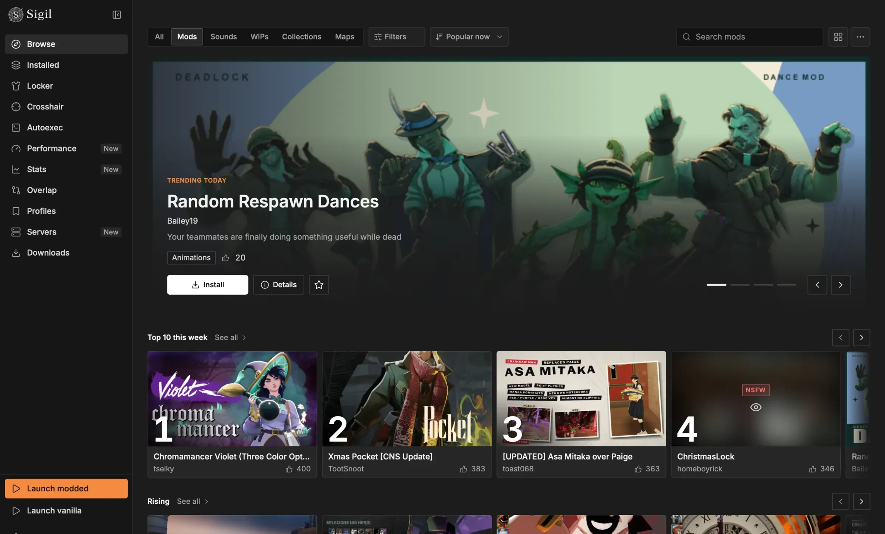
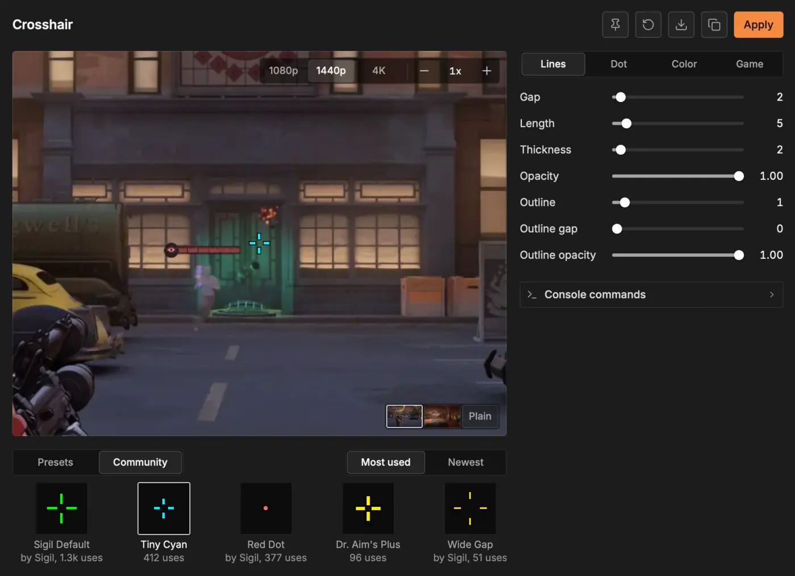

# Sigil

Sigil is a free, open-source mod manager for [Deadlock](https://store.steampowered.com/app/1422450/Deadlock/)
on Windows. It finds and installs mods from GameBanana, keeps load order and overlapping mods in
view, fixes `gameinfo.gi` after game updates, and starts the game modded or vanilla.



## Download

**[Download Sigil for Windows (Sigil-Setup.exe)](https://github.com/superuserkalo/sigil/releases/latest/download/Sigil-Setup.exe)**

- Windows 10 and 11, 64-bit. The installer is per user and needs no administrator rights.
- The installer is not code signed yet, so Windows may show "Windows protected your PC". Choose
  More info, then Run anyway.
- Prefer no installer? The same app is a single `Sigil.exe` in
  [Sigil-windows-x64.zip](https://github.com/superuserkalo/sigil/releases/latest/download/Sigil-windows-x64.zip).
- Sigil updates itself from signed GitHub releases once you allow the update check.
- Website and guides: [sigilmods.app](https://sigilmods.app). Every release and its notes:
  [Releases](https://github.com/superuserkalo/sigil/releases).

The first start takes three steps: find Deadlock, let the game load mods (Sigil backs up
`gameinfo.gi` and adds the `addons` line), and choose whether to allow update checks and share
product data. Both are off until you say yes.

## What it does

- **Browse.** GameBanana's Deadlock catalog inside the app: tabs, categories, heroes, filters,
  trending rails, mod pages, creators and favourites. Mod search runs on your PC against a public
  index Sigil downloads, forgives typos and knows what many mods are based on. Install lists the
  archive's files first, flags programs and scripts, and lands the mod in a free slot, switched off
  by default.
- **Installed.** Every mod in the addons folder, however it got there: on and off, drag to set
  the load order, update checks, trash with Undo, backups of replaced versions, a mod safety
  review, an addons folder analysis and a halving search for a mod that breaks the game. Past 99
  mods Sigil adds extra folders.
- **Overlap.** Which mods replace the same files and which one the game will use; swap or switch
  one off.
- **Launch modded and vanilla.** Modded checks your mods and fixes `gameinfo.gi` when a game update
  or a Steam file check reset it. Vanilla sets your mods aside and brings them back afterwards. If
  the game crashes, Sigil reads the dump and names the mod that was loading when it can.
- **Locker.** Your mods by hero: equip a skin, run several and shuffle on launch, game sounds and
  art, in-game card art and cursors. A 3D preview of the hero with the mod on is an early feature.
- **Crosshair.** Edit at true scale over a game scene, share and import codes, apply to your
  autoexec or the game's hero settings, and browse, apply and publish crosshairs in the community
  library.

  

- **Profiles and packs.** Save a whole setup, switch in one step, share it as a code or a file;
  imports download what is missing. A profile can keep its own addons folder.
- **Autoexec.** Edit `autoexec.cfg` with a searchable command library, keep Sigil's lines apart
  from yours, and save Steam launch options.
- **Performance.** Community configs for `gameinfo.gi` with your own overrides, a convar editor
  and an in-game benchmark (the benchmark has not been run against a real game yet).
- **Stats.** Rank, heroes, matches, items, party and leaderboard from deadlock-api, once you turn
  Player stats on.
- **Servers.** Deadworks community servers with ping and filters, joins that fetch the content a
  server needs, and relay region blocking through Windows Firewall.
- **Private by default.** No account and no third-party analytics. Usage events, crash reports,
  match data sharing and "Help build Sigil" product data are each off until you agree, and Offline
  mode stops Sigil's own requests. [docs/privacy.md](docs/privacy.md) lists every host and field.

An agent that builds mods from a prompt (bring your own model key) is in the app behind Settings >
Experimental > Agent. It is off by default and still experimental.

## Requirements

- To play: Windows 10 or 11, 64-bit, and Deadlock from Steam. That is the only released platform.
- To build: Rust (the pinned toolchain in `rust/rust-toolchain.toml` installs through rustup), git,
  and Node 24 for the release scripts and the Worker tests.
- macOS and Linux: the app builds and runs there for development and the tests, and
  `scripts/package-desktop.sh` and `scripts/package-linux.sh` produce a macOS bundle, an AppImage
  and a `.deb`. None of those are released or checked against a real game install, and Windows-only
  parts (firewall rules, hosting a server) do nothing there.

## Build from source

```bash
git clone https://github.com/superuserkalo/sigil.git
cd sigil
./scripts/vendor-rune.sh                                    # pinned Rune UI toolkit into vendor/rune
cargo run --manifest-path rust/Cargo.toml -p dah-desktop    # or: pnpm rust:app
```

The Locker's hero art comes from the Grimoire project and is optional for a development build:
`./scripts/vendor-grimoire.sh` then `./scripts/pack-locker-art.sh .scratch/locker-art` (needs
`cwebp`) builds it in.

Tests:

```bash
cd rust && cargo test -p dah-desktop -p deadlock-core
cd services/telemetry && npm ci && npm test                 # the Cloudflare Worker
```

A Windows build from macOS or Linux: `scripts/package-windows.sh` (cargo-xwin), then
`scripts/package-installer.sh` (NSIS) for the installer. See
[docs/runbooks/development.md](docs/runbooks/development.md) and
[docs/runbooks/releasing.md](docs/runbooks/releasing.md).

## Repository layout

```text
rust/crates/desktop        the Sigil app (Rune UI); also runs as `Sigil cli` and `Sigil agent-host`
rust/crates/deadlock-core  game discovery, VPK, installs, load order, launch, crosshair, stats
rust/crates/sigil-viewer   the 3D viewer (wgpu)
rust/crates/dah-rs         the command line interface
rust/crates/agent-host     the experimental agent host, on rust/crates/tinyagent
services/telemetry         Sigil's Cloudflare Worker: opt-in telemetry, search index, crosshairs
scripts/                   vendoring, packaging, installer and release signing
site/                      the sigilmods.app website
docs/                      user guide, privacy notes, decisions, research and runbooks
```

## Documentation

- [User guide](docs/user-guide.md) and the [FAQ](https://sigilmods.app/faq)
- [Privacy and network activity](docs/privacy.md)
- [Docs index](docs/README.md): decisions, Deadlock modding facts, runbooks
- [Contributing](CONTRIBUTING.md), [Code of conduct](CODE_OF_CONDUCT.md),
  [Security policy](SECURITY.md)
- [Licence (MIT)](LICENSE) and [third-party notices](THIRD_PARTY_NOTICES.md)

Coding agents working in this repository start at [AGENTS.md](AGENTS.md).

## Licence

MIT. Sigil builds on Rune, TinyAgent, Grimoire's art and other open-source projects; their
licences and notices are in [THIRD_PARTY_NOTICES.md](THIRD_PARTY_NOTICES.md).

Sigil is a fan project and is not affiliated with or endorsed by Valve. Deadlock is a trademark of
Valve Corporation. Mods come from GameBanana and belong to their creators.
